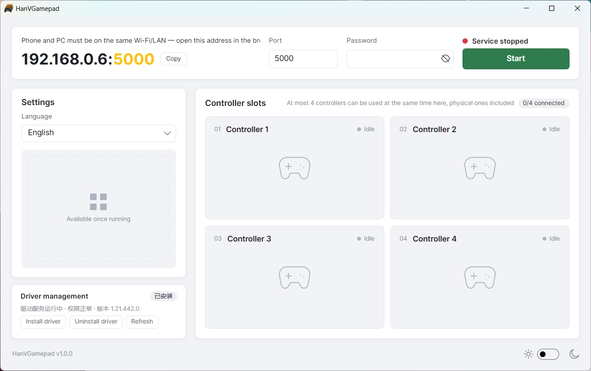
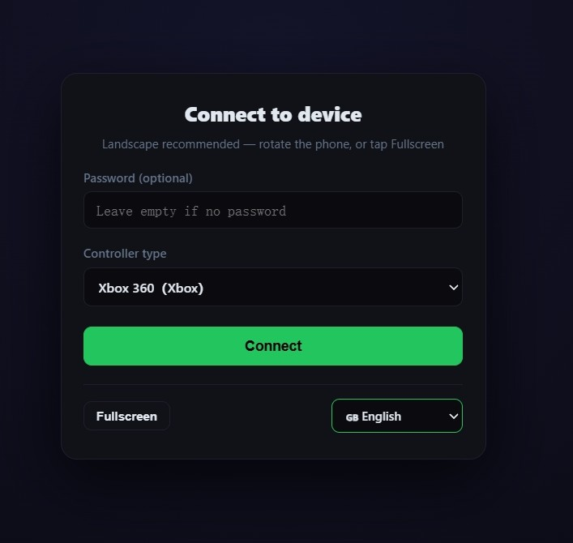

# HanVGamepad

English | [简体中文](README.zh.md)

Turn any smartphone browser into a virtual PC gamepad. With the phone and PC on
the same Wi-Fi / LAN, open the host address in the phone browser and it works as
an Xbox 360 / DualShock 4 virtual controller. Input travels over a WebRTC
DataChannel with low latency, with rumble feedback, four player slots,
disconnect slot memory, and password protection.

Hosts are available for Windows (ViGEmBus), Linux (uinput), and macOS (output
through OpenJoystickDriver).

## Features

- **Cross-platform host**: Windows / Linux / macOS
- **Low-latency input**: SignalR signaling + WebRTC DataChannel, < 30ms end-to-end on LAN
- **Four gamepad slots**: local multiplayer; slots are released on disconnect and reclaimed by device code / IP memory
- **Two controller types**: Xbox 360 / DualShock 4 (Linux and macOS hosts map to Xbox 360)
- **Rumble feedback**: game vibration forwarded to the phone in real time (Windows and macOS)
- **Zero-install client**: works in iOS Safari / Android Chrome / desktop browsers
- **Desktop control panel**: service status / QR code / slot management / driver management / i18n (Chinese, English, Arabic)
- **CLI mode**: run headless from the command line

## Screenshots

| Host control panel | Phone client |
|:---:|:---:|
|  |  |

## Getting started

### Prerequisites: build

```powershell
# Backend (.NET 10)
dotnet build HanVGamepad.slnx

# Mobile page (outputs to src/desktop/wwwroot/)
cd web-client
npm install
npm run build
```

### Windows desktop panel

```powershell
dotnet run --project src/desktop
```

1. On first use, click "Install driver" in the Driver Management section (UAC prompt; installs ViGEmBus).
2. Click "Start service".
3. Scan the QR code on the panel (or enter the address manually), pick a controller type, and connect.

### CLI (headless / development)

```powershell
dotnet run --project src/cli -- start --port 5000 --password ""
```

```text
hanvgamepad start [--port <1-65535>] [--password <pwd>]   Run the service in the foreground (Ctrl+C to stop)
hanvgamepad stop                                          Stop the background instance
hanvgamepad status                                        Show service and driver status
hanvgamepad driver status|install|uninstall               Driver management
```

### Linux

```bash
# One-time uinput permission setup (modprobe + udev rule for /dev/uinput)
sudo modprobe uinput
echo uinput | sudo tee /etc/modules-load.d/hanvgamepad.conf
sudo tee /etc/udev/rules.d/99-hanvgamepad.rules <<'EOF'
KERNEL=="uinput", SUBSYSTEM=="misc", OPTIONS+="static_node=uinput", TAG+="uaccess", GROUP="input", MODE="0660"
EOF
sudo udevadm control --reload-rules && sudo udevadm trigger
sudo usermod -aG input $USER    # takes effect after re-login

# Run
dotnet run --project src/desktop      # desktop panel
dotnet run --project src/cli -- start --port 5000   # headless
```

### macOS

macOS cannot ship a virtual gamepad driver: creating virtual HID devices requires
Apple's restricted entitlement (`com.apple.developer.hid.virtual.device`).
HanVGamepad outputs gamepads through [OpenJoystickDriver](https://github.com/xsyetopz/OpenJoystickDriver) (OJD):

1. Install OJD (macOS 12+) and install its `ojd` command-line tool from its settings.
2. Grant OJD Input Monitoring and Accessibility permissions.
3. Run `ojd service start`.
4. Start HanVGamepad (the Driver Management section shows whether OJD is ready).

```bash
dotnet run --project src/desktop      # desktop panel
dotnet run --project src/cli -- start --port 5000   # headless
```

The macOS host is fixed to four slots (OJD's feed limit).

## Packaging and releases

```powershell
pwsh windows-build.ps1                     # Windows: interactive (portable folder + installer)
pwsh windows-build.ps1 -Clean              # Clean old outputs and do a full build
pwsh windows-build.ps1 -NoInstaller        # Portable folder only (when Inno Setup is missing)
pwsh windows-build.ps1 -SkipWeb -Version 1.1.0
```

Windows outputs: `artifacts\win-x64\HanVGamepad\` (portable folder; double-click `HanVGamepad.Desktop.exe`),
`artifacts\packages\HanVGamepad-<ver>-win-x64-portable.zip`, and
`artifacts\packages\HanVGamepad-<ver>-win-x64-setup.exe` (Inno Setup).
Releases use an expanded directory layout, not a self-extracting single-file exe.
See [packaging/windows/README.md](packaging/windows/README.md) for details.

Other platforms:

```powershell
pwsh packaging/build.ps1                     # All platforms
pwsh packaging/build.ps1 -Runtime osx-arm64  # macOS only (Apple silicon)
```

## Project layout

```text
HanVGamepad/
├── src/
│   ├── server/     Cross-platform core service (SignalR hub / WebRTC sessions / slot management)
│   ├── driver/     Virtual gamepad driver abstraction (Windows ViGEmBus / Linux uinput / macOS OpenJoystickDriver)
│   ├── desktop/    Avalonia UI control panel (Windows + Linux + macOS)
│   └── cli/        Headless console entry point
├── web-client/     Mobile React SPA (build output embedded into the host wwwroot)
├── docs/           Architecture / protocol / driver setup docs
├── packaging/      Per-platform packaging scripts
└── tests/          Test projects
```

## Tech stack

| Layer | Technology |
|-------|------------|
| Core service | .NET 10 + ASP.NET Core (Kestrel) + SignalR |
| Real-time transport | WebRTC DataChannel (SIPSorcery, fully managed) |
| Virtual gamepad | Windows: ViGEmBus (Nefarius.ViGEm.Client); Linux: uinput; macOS: OpenJoystickDriver (`ojd virtual feed`) |
| Desktop UI | Avalonia UI 11 + CommunityToolkit.Mvvm |
| Mobile | React 19 + Vite + TypeScript |

## Protocol

Signaling uses SignalR (`/gamepadhub`); input uses a WebRTC DataChannel (plain text):

| Message | Direction | Meaning |
|---------|-----------|---------|
| `B:{button}:{0\|1}` | Phone → host | Button |
| `J:{stick}:{x}:{y}` | Phone → host | Stick (short, −32768..32767) |
| `Ping:{ts}` / `Pong:{ts}` | Bidirectional | Heartbeat |
| `ID:{slotIndex}` | Host → phone | Slot assignment |
| `V:{strength}` | Host → phone | Rumble strength (0..255) |

## Origin and attribution

This project is a fork of [aboodedc/VGamepadWeb](https://github.com/aboodedc/VGamepadWeb)
that was subsequently rewritten end to end: the desktop app moved to Avalonia 11, the
server was split into server / driver / cli layers, a Linux uinput backend and the
driver install / detect / uninstall flow were added, and the mobile page and tech stack
were rebuilt.

The original project is MIT licensed; its copyright notice is kept in
[LICENSE-ORIGINAL](LICENSE-ORIGINAL).

## License

[PolyForm Noncommercial License 1.0.0](https://polyformproject.org/licenses/noncommercial/1.0.0) —
full terms in [LICENSE](LICENSE).

**Permitted**: personal study, research, private enjoyment, hobby projects; noncommercial
use by charities, educational institutions, public research institutions, public safety
and health organizations, environmental organizations, and government institutions.

**Prohibited**: selling the software, providing commercial services with it, or any use
for commercial gain.

**Attribution**: distributions must include the following copyright notice line (PolyForm's
Required Notice mechanism).

```text
Required Notice: Copyright (c) 2026 涵涵大王
```
