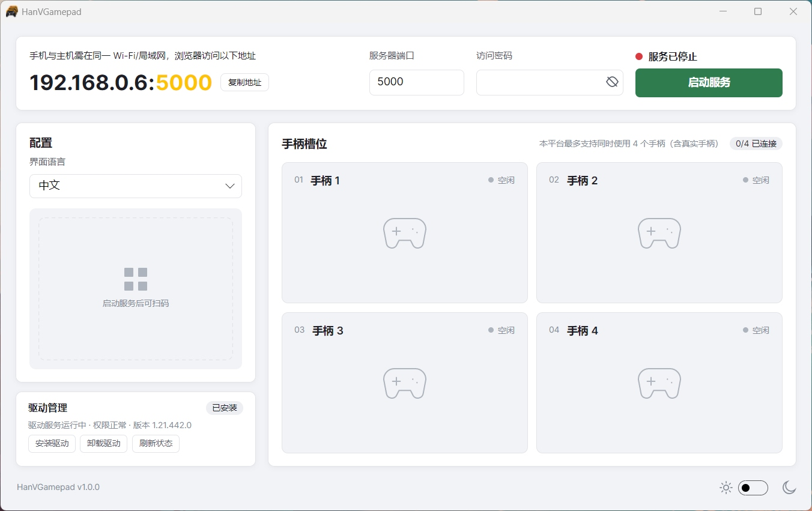
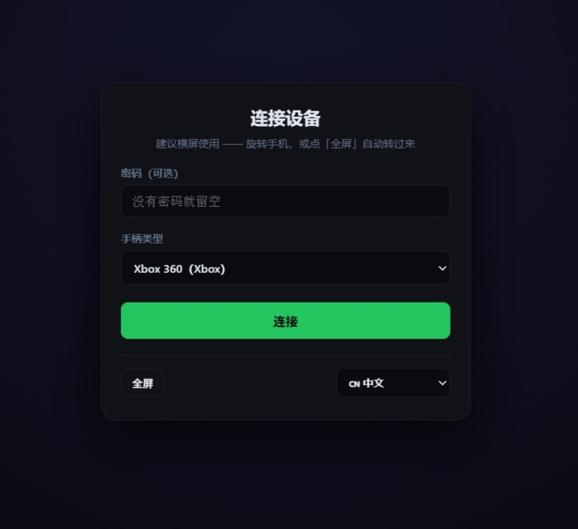
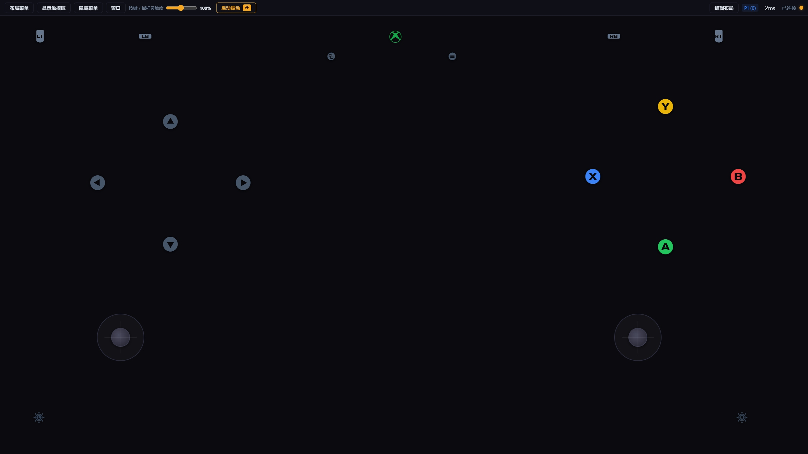

# HanVGamepad

[](README.md)


把任意智能手机的浏览器变成 PC 虚拟手柄。手机与电脑连同一 Wi-Fi / 局域网，
手机浏览器打开宿主地址即可作为 Xbox 360 / DualShock 4 虚拟手柄使用，
输入通过 WebRTC DataChannel 低延迟传输，支持振动反馈、4 槽位多人、
断线槽位记忆与密码保护。

支持 Windows（ViGEmBus）、Linux（uinput）与 macOS（通过 OpenJoystickDriver 输出）三平台宿主。

## 功能

- **跨平台宿主**：Windows / Linux / macOS
- **低延迟输入**：SignalR 信令 + WebRTC DataChannel，局域网端到端延迟 < 30ms
- **4 个手柄槽位**：多人同乐，断线自动释放、重连认回原槽位（设备码 / IP 记忆）
- **两种手柄类型**：Xbox 360 / DualShock 4（Linux 端与 macOS 端以 Xbox 360 映射工作）
- **振动反馈**：游戏振动实时回传手机（Windows 与 macOS）
- **零安装客户端**：iOS Safari / Android Chrome / 桌面浏览器直接访问
- **桌面管理面板**：服务状态 / QR 扫码 / 槽位管理 / 驱动管理 / 多语言（中/英/阿）
- **CLI 模式**：headless 场景下以命令行运行服务
- **屏幕布局可编辑**：按键拖到顺手指的位置，另有触摸区调试视图、按键/摇杆灵敏度滑杆、振动开关与全屏切换
- **手机页面多语言**：简体中文 / English / العربية

## 界面截图

### 服务端面板

局域网地址与二维码、四路手柄槽位、驱动管理、明暗主题开关——宿主侧一个窗口看全：



### 手机客户端

扫码打开手机页面，选好手柄类型点连接，横屏就能玩：

| 连接页 | 横屏手柄 |
|:---:|:---:|
|  |  |

## 启动方法

### 前置：构建

```powershell
# 后端（.NET 10）
dotnet build HanVGamepad.slnx

# 移动端页面（产物输出到 src/desktop/wwwroot/）
cd web-client
npm install
npm run build
```

### Windows 桌面面板

```powershell
dotnet run --project src/desktop
```

1. 首次使用在「驱动管理」区点「安装驱动」（弹出 UAC 提权，安装 ViGEmBus）
2. 点「启动服务」
3. 手机扫描面板二维码（或手动输入地址），选手柄类型，点连接

### CLI（headless / 开发调试）

```powershell
dotnet run --project src/cli -- start --port 5000 --password ""
```

```text
hanvgamepad start [--port <1-65535>] [--password <pwd>]   前台运行服务（Ctrl+C 停止）
hanvgamepad stop                                          停止后台实例
hanvgamepad status                                        查看服务与驱动状态
hanvgamepad driver status|install|uninstall               驱动管理
```

### Linux

```bash
# 一次性 uinput 权限配置（modprobe + /dev/uinput 的 udev 规则）
sudo modprobe uinput
echo uinput | sudo tee /etc/modules-load.d/hanvgamepad.conf
sudo tee /etc/udev/rules.d/99-hanvgamepad.rules <<'EOF'
KERNEL=="uinput", SUBSYSTEM=="misc", OPTIONS+="static_node=uinput", TAG+="uaccess", GROUP="input", MODE="0660"
EOF
sudo udevadm control --reload-rules && sudo udevadm trigger
sudo usermod -aG input $USER    # 重新登录后生效

# 运行
dotnet run --project src/desktop      # 桌面面板
dotnet run --project src/cli -- start --port 5000   # headless
```

### macOS

macOS 不能自带虚拟手柄驱动：创建虚拟 HID 需要 Apple 的受限 entitlement
（`com.apple.developer.hid.virtual.device`）。HanVGamepad 通过 [OpenJoystickDriver](https://github.com/xsyetopz/OpenJoystickDriver)（OJD）输出手柄：

1. 安装 OJD（macOS 12+），在它的设置里安装命令行工具 `ojd`；
2. 授予 OJD 输入监控与辅助功能；
3. `ojd service start`；
4. 再启动 HanVGamepad（驱动管理区会显示 OJD 是否就绪）。

```bash
dotnet run --project src/desktop      # 桌面面板
dotnet run --project src/cli -- start --port 5000   # headless
```

macOS 端固定 4 个槽位（OJD 的 feed 上限）。

## 打包发布

```powershell
pwsh windows-build.ps1                     # Windows：交互式（绿色包 + 安装包）
pwsh windows-build.ps1 -Clean              # 清理旧产物后全量构建
pwsh windows-build.ps1 -NoInstaller        # 只出绿色包（没装 Inno Setup 时）
pwsh windows-build.ps1 -SkipWeb -Version 1.1.0
```

Windows 产物：`artifacts\win-x64\HanVGamepad\`（绿色包目录，双击 `HanVGamepad.Desktop.exe` 直接跑）、
`artifacts\packages\HanVGamepad-<ver>-win-x64-portable.zip`、
`artifacts\packages\HanVGamepad-<ver>-win-x64-setup.exe`（Inno Setup）。
发布固定为目录展开形态，不用单文件自解压 exe。细节见 [packaging/windows/README.md](packaging/windows/README.md)。

其他平台：

```powershell
pwsh packaging/build.ps1                     # 全平台产物
pwsh packaging/build.ps1 -Runtime osx-arm64  # 仅 macOS（Apple silicon）
```

## 项目结构

```text
HanVGamepad/
├── src/
│   ├── server/     跨平台核心服务（SignalR Hub / WebRTC 会话 / 槽位管理）
│   ├── driver/     虚拟手柄驱动抽象层（Windows ViGEmBus / Linux uinput / macOS OpenJoystickDriver）
│   ├── desktop/    Avalonia UI 管理面板（Windows + Linux + macOS）
│   └── cli/        无 UI 控制台入口
├── web-client/     移动端 React SPA（构建产物内嵌到宿主 wwwroot）
├── packaging/      各平台打包脚本
└── tests/          测试项目
```

## 技术栈

| 层 | 技术 |
|----|------|
| 核心服务 | .NET 10 + ASP.NET Core (Kestrel) + SignalR |
| 实时传输 | WebRTC DataChannel（SIPSorcery，纯托管） |
| 虚拟手柄 | Windows: ViGEmBus（Nefarius.ViGEm.Client）；Linux: uinput；macOS: OpenJoystickDriver（`ojd virtual feed`） |
| 桌面 UI | Avalonia UI 11 + CommunityToolkit.Mvvm |
| 移动端 | React 19 + Vite + TypeScript |

## 通信协议

信令走 SignalR（`/gamepadhub`），输入走 WebRTC DataChannel（纯文本）：

| 消息 | 方向 | 含义 |
|------|------|------|
| `B:{button}:{0\|1}` | 手机→宿主 | 按键 |
| `J:{stick}:{x}:{y}` | 手机→宿主 | 摇杆（short，−32768..32767） |
| `Ping:{ts}` / `Pong:{ts}` | 双向 | 心跳 |
| `ID:{slotIndex}` | 宿主→手机 | 槽位确认 |
| `V:{strength}` | 宿主→手机 | 振动强度（0..255） |

## 来源与署名

本项目 fork 自 [aboodedc/VGamepadWeb](https://github.com/aboodedc/VGamepadWeb)，之后做了整体重写：
桌面端改为 Avalonia 11，服务端拆分为 server / driver / cli 三层，新增 Linux uinput 后端与
驱动的安装 / 检测 / 卸载流程，移动端页面与技术栈一并重做。

原项目采用 MIT License，其版权声明随仓库保留在 [LICENSE-ORIGINAL](LICENSE-ORIGINAL)。

## 许可证

[PolyForm Noncommercial License 1.0.0](https://polyformproject.org/licenses/noncommercial/1.0.0) —— 完整条款见 [LICENSE](LICENSE)。

**允许**：个人学习、研究、私人娱乐、业余项目；慈善机构、教育机构、公共研究机构、公共安全与卫生机构、环保组织、政府机构的非营利用途。

**禁止**：出售本软件、用本软件提供商业服务，或任何以商业获利为目的的使用。

**署名**：分发时必须一并提供以下版权声明行（PolyForm 的 Required Notice 机制）。

```text
Required Notice: Copyright (c) 2026 涵涵大王
```

